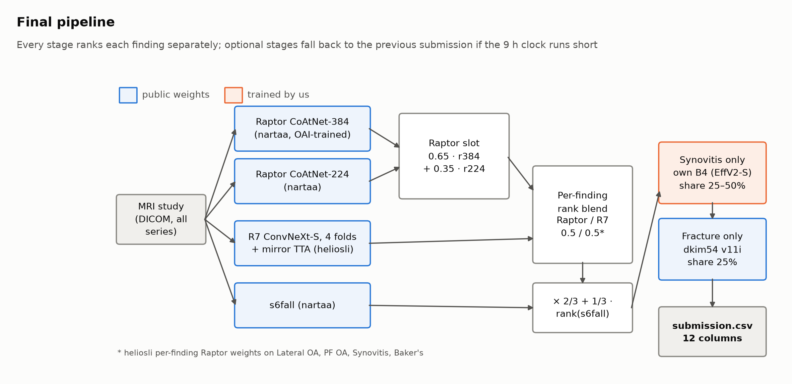
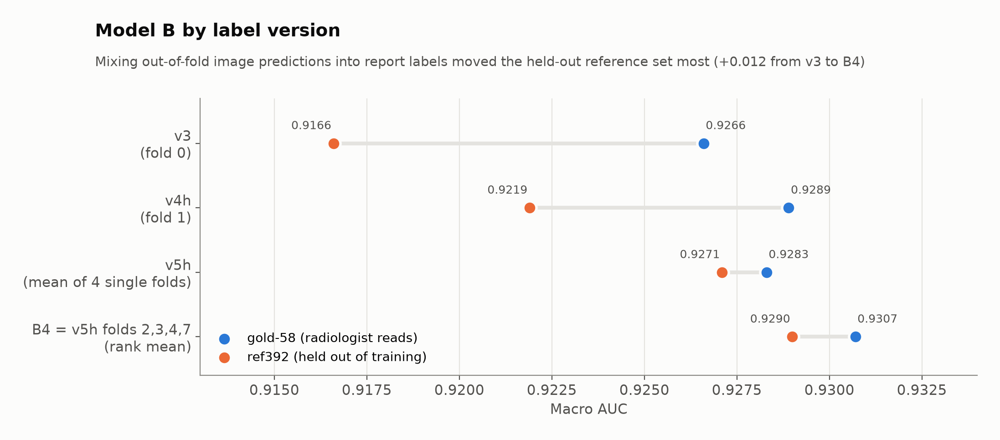
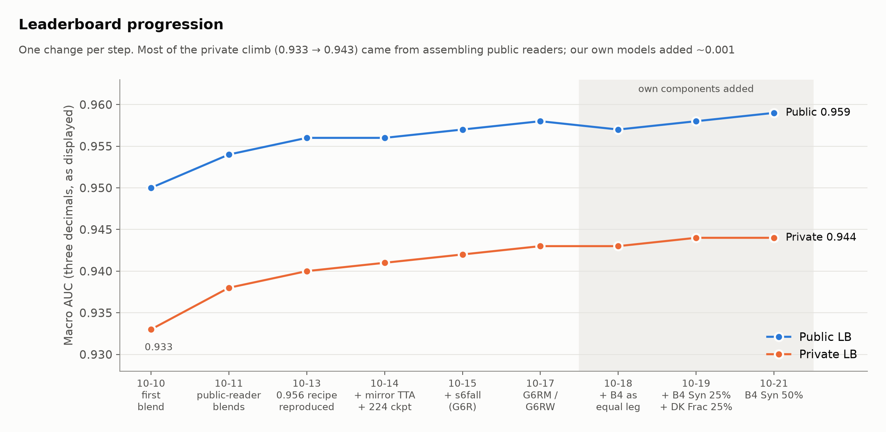
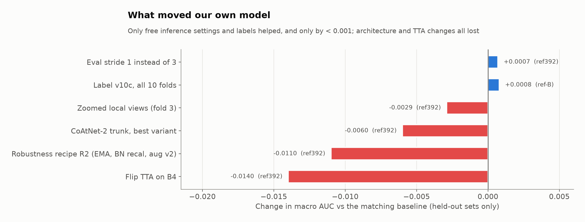
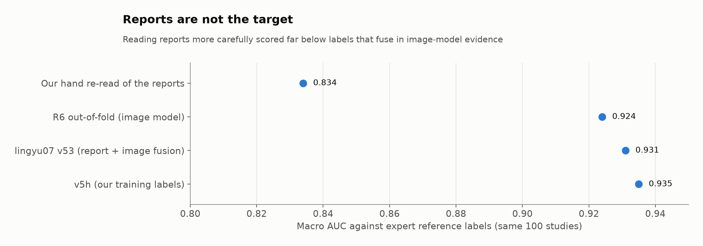

# 223rd Place Solution (Top 4%): Public Readers, Measured Specialists, and an Honest Look at the Label Ceiling

**Team HPDA thì ngon luôn** (dunguit, giaanp, hinnguync, mphatfromuit, nguynxunphc662)

| | Public LB | Private LB |
|---|---|---|
| Best-scoring entry | 0.959 | 0.944 |
| Final standing | | **223rd / 6,299** |

We thank RSNA, Kaggle, the participating institutions and radiologists, and the many competitors who published models,
labels, and analysis. Our final ensemble is built on public work, credited in full at the end. The parts we built
ourselves are a self-trained study reader (model **B**), a label-distillation chain for it, two finding-specific
specialists, and an evaluation protocol that let us decide changes without fitting the public leaderboard.

---

## TL;DR

- **Base:** a rank blend of three public readers: nartaa's Raptor CoAtNet (384 px, plus the 224 px checkpoint inside the same
  slot), heliosli's R7 ConvNeXt-S with anatomical-mirror TTA, and nartaa's s6fall as a third leg.
- **Own model B:** EfficientNetV2-S on knee-centred 2.5D views, trained on 4,349 report-only studies with distilled soft
  labels (report labels blended 50/50 with out-of-fold image-model predictions). Solo public score 0.950.
- **Specialists:** B takes a 25 to 50% share of the **Synovitis** column only, and the public dkim54 v11i reader takes 25% of
  **Fracture** only. Shares were fixed before each submission, never fitted.
- **Evaluation:** gold-58 plus 392 reference-labelled studies that no model of ours ever trained on. These two sets, not the
  public LB, decided every change.
- **What held us back:** our labels came from reports. Every label route we tried saturated near 0.93 macro AUC on the
  reference set, while the top teams built labels from **images** (LLM image reads, OAI expert grades). That is the gap
  between 0.944 and 0.959 private.

---

## 1. Problem framing

- 4,407 training studies, but only **58** carry radiologist image labels (gold-58). The other 4,349 have a free-text,
  multilingual report and no labels.
- The target is an **image re-read**, not the report. Reports omit findings (Synovitis especially) and describe changes
  below the positive threshold.
- Metric: macro AUC over 12 findings. Every column is ranked separately, so **per-finding rank blending** is natural and
  calibration across models does not matter.
- Inference: offline notebook on 2×T4 within 9 hours, roughly 1,300 hidden test studies. Runtime was a hard design constraint:
  every stage of our notebook checks the remaining clock and falls back to the previous submission if it cannot finish.

## 2. Evaluation protocol: deciding without the public LB

The public LB covers about 390 studies, and the top of the board sat inside a 0.006 band. We did not trust it to rank
small changes, so we fixed two offline sets early:

| Set | Studies | Labels | Rule |
|---|---|---|---|
| **gold-58** | 58 | radiologist image reads (host) | never trained on by our own models |
| **ref392** | 392 | public expert reference labels (zoliseress) | held out of every label version we trained on |

From 10-19 we split ref392 by `md5(uid) % 2`: **ref-A** (161 studies) could be used for training, and **ref-B** (231) plus
gold-58 remained the only fair test for models trained after that point.

Two caveats shaped how we read these numbers:

1. Most public checkpoints were trained on the ref392 studies, so on ref392 only **out-of-fold** public predictions are a
   fair comparison (for example R6 OOF, 0.9155).
2. Gold-58 has only 9 to 35 positives per finding. We treated differences below about 0.003 macro as noise and looked at
   per-finding consistency across both sets before accepting a change.

**Blend-weight policy.** The default was equal weights per leg. We did **not** fit weights on gold-58 or on the public LB for our
own components. The one exception is the per-finding Raptor/R7 weights published by heliosli (Synovitis 0.8, Lateral OA
0.2, PF OA 0.6, Baker's 0.35), which our final base inherits. We debated this, because those weights came from public-LB
feedback. In the end the weighted and unweighted bases scored the same on private (0.943), so the choice did not matter.

## 3. Final pipeline



*Figure 1. Public readers (blue) and our own model (orange). Every arrow carries 12 per-finding ranks.*

```
Stage 1   Raptor CoAtNet-384 SWA (nartaa, OAI-trained)                       ┐
Stage 2b  Raptor CoAtNet-224 checkpoint, inside the Raptor slot (share 0.35) ├─ Raptor slot
Stage 2   R7 ConvNeXt-S, 4 folds + stackers (heliosli) + anatomical-mirror TTA ── R7 slot
Stage 3   per-finding rank blend: Raptor slot vs R7 slot (0.5 / 0.5; heliosli per-finding weights on 4 findings)
Stage 4   s6fall (nartaa) as a third leg: final = 2/3 · stage 3 + 1/3 · rank(s6fall)
Stage 6   Synovitis only: (1 − w) · rank(blend) + w · rank(own B4),  w = 0.25 (best private) or 0.5 (best public)
Stage DK  Fracture only:  0.75 · rank(blend) + 0.25 · rank(dkim54 v11i, 10 checkpoints, no TTA)
```

Larger specialist shares (Synovitis 0.625, Fracture 0.5) scored 0.958 / 0.943, so the extra weight did not pay off on
either leaderboard.

Engineering details that mattered on Kaggle:

- **Mirror TTA for R7.** R7 was trained with left/right mirroring (p = 0.5) but ships with TTA off. We average the plain
  logits with a mirrored pass, re-indexing Medial↔Lateral and taking MCL from the plain pass only.
- **Failure handling.** Each model is ranked over its own scored studies. A study one model failed on takes the other
  model's rank. The notebook stops if more than 3% of Raptor studies or more than 50% of our own stage fail.
- **Time budget.** Optional stages (224 px checkpoint, s6fall, specialists) run only if the 9-hour clock allows, and every one
  keeps a copy of the previous `submission.csv` to fall back to.

## 4. Our own reader: model B

### 4.1 Architecture and input

B uses heliosli's compact study pipeline (trainer v9.8 with our multi-shard and fp16 patches):

- **Input:** knee-centred "v4" views at 256 px, centre-cropped to 224 px. The input is 3 adjacent slices at 3.5 mm physical
  spacing, plus local views around anatomy anchors.
- **Backbone:** `tf_efficientnetv2_s.in21k_ft_in1k` with spatial attention and the `E_prior` arm.
- **Training:** 16 epochs, 10 hash folds; each fold model trains on the other nine folds.
- **Inference:** rank mean over folds, eval stride 1. Stride 1 was +0.0007 on ref392 over stride 3, at the same wall time
  because decoding dominates.

### 4.2 Labels: distillation beats re-reading reports

| Version | Definition |
|---|---|
| old | mean of two public report-label sets (stevenleehans v4_blend, pilkwang report_labels_v2) |
| v3 | 0.5 · old + 0.5 · R6 out-of-fold image predictions, on the 5 weakest findings |
| v4h | 0.5 · old + 0.5 · R6 OOF, all 12 findings |
| **v5h** | 0.5 · lingyu07 v53 master labels + 0.5 · R6 OOF |
| v10c / v11c | multi-teacher mixes; v10c adds the ref-A expert labels (0/1 mapped to 0.02/0.98) |

The R6 OOF predictions come from heliosli's 4-fold R6 model: each study is scored by the fold that did **not** train on it.
Blending an image model's opinion into report labels gave the largest single gain we found on our own models:

| Model B (EffV2-S) | gold-58 | ref392 |
|---|---|---|
| fold 0, labels v3 | 0.9266 | 0.9166 |
| fold 1, labels v4h | 0.9289 | 0.9219 |
| folds 2/3/4/7, labels v5h (mean of single folds) | 0.9283 | 0.9271 |
| **B4 = rank mean of folds 2, 3, 4, 7 (v5h)** | **0.9307** | **0.9290** |
| all 8 trained folds | 0.9345 | 0.9279 |



*Figure 2. The held-out reference set (orange) moved by +0.012 from v3 to B4. The radiologist set (blue) has too few
positives to separate label versions reliably.*

B4 scored **0.950 public as a single model**. That matches s6fall, which was trained on the reference studies we kept out
of training.

### 4.3 Where B helps the blend

B is weaker than the public blend on average, but it is the strongest model we had on **Synovitis**, the finding reports
under-describe most. Adding B as an equal leg on all 12 columns did not help (public 0.957 for both a 1/8 and a 1/4 share,
private 0.943 for both). Restricting it to the Synovitis column did help, which is why it enters only there.

For the Synovitis slot we also trained a **ViT-S DINOv2** variant (`--lr 5e-5 --llrd 0.8`, label v10c). It was weaker
overall but best on Synovitis (ref-B 0.932 vs 0.913 for B-v10c). A rank mean of B and ViT-S was submitted as a
co-specialist. It scored the same as B alone on both leaderboards (0.958 / 0.943 at a 62.5% share), so our best entries
keep B4 alone.

## 5. Leaderboard progression

Each step changed one thing. Scores are as displayed by Kaggle, to three decimals.



| Date | Entry | Public | Private |
|---|---|---|---|
| 10-10 | first blend | 0.950 | 0.933 |
| 10-11 | early public-reader blends | 0.954 | 0.937–0.939 |
| 10-13 | 0.956 public recipe reproduced (Raptor-384 + R7, rank 0.5/0.5) | 0.956 | 0.940 |
| 10-14 | + R7 anatomical-mirror TTA, 224 px checkpoint in the Raptor slot | 0.956 | 0.941 |
| 10-15 | + s6fall as a third leg (G6R) | 0.957 | 0.942 |
| 10-17 | G6RM (+ mirror TTA on the 224 checkpoint) / G6RW (+ heliosli per-finding weights) | 0.958 | 0.943 |
| 10-18 | G6RM + B4 as a 4th equal leg (1/8 or 1/4) | 0.957 | 0.943 |
| 10-19 | G6RW + B4 on Synovitis (25%) + dkim54 on Fracture (25%) | 0.958 | **0.944** |
| 10-21 | B4 Synovitis share 50%, Fracture 25% | **0.959** | **0.944** |
| 10-21 | B4 Synovitis 62.5%, Fracture 50% (with or without ViT-S) | 0.958 | 0.943 |

**Private gain from our own components:** about +0.001 on top of the public base (0.943 → 0.944). Most of the climb
from 0.933 came from assembling public readers correctly: rank blending, mirror TTA, the unused 224 px checkpoint, and
s6fall.

## 6. What did not work

We report these because each one cost real compute, and the reasons are more useful than the scores.





*Figure 5. Macro AUC against expert reference labels on the same 100 studies. Careful report reading cannot recover
findings the report never mentions.*

| Idea | Result | Why we think it failed |
|---|---|---|
| **Hand re-labelling reports** (100 ref392 reports, fixed rubric learned from gold-58) | macro AUC 0.834 vs ref labels; lingyu07 v53 reaches 0.931; blending ours in lowered it to 0.906 | Reports are not the target. Gold examples include a normal report with Baker's positive. Strong public labels are good because they are fused with image models. |
| **Zoomed local views** (centre 60% re-sized, folds 2/3) | ref392 0.9236 vs 0.9265; MCL −0.034 | v4 locals are already close to native resolution (2.56 px/mm). Zooming adds no information and pushes MCL to the crop edge. |
| **Flip TTA on B** | −0.014 on ref392 | v4 views already canonicalise the side, so the mirrored pass is a worse view of the same knee. |
| **Label routes v10c / v11c** (multi-teacher, ref-A expert labels) | all 10 v10c folds: ref-B +0.0008, gold +0.0003 over B4; v11c gold −0.002 | Labels had saturated: the best mix reached 0.933 ref392 macro against an oracle ceiling of about 0.939. The early "+0.002" came from a lucky fold subset. |
| **Robustness recipe R2** (EMA, BN recalibration, stronger augmentation, slice jitter) | ref392 0.914–0.918 vs 0.926–0.928 | Over-regularised for 16 epochs on noisy soft labels. |
| **CoAtNet-2 in the Raptor geometry** (own) | ref392 0.917–0.923, below B | Same labels, a different trunk, and no new information. |
| **Baker's specialist** (B on Baker's, 25%) | dropped after the public order showed it hurting | |
| **Stacking and cross-finding models on our own predictions** | no gain on ref-B or gold-58 | Too few clean labels to fit anything beyond rank means. |

## 7. Compute

- **Kaggle:** 2×T4 notebooks for inference and the early training. The weekly GPU quota was the binding limit.
- **Modal:** A100 GPUs for the B family (one container per fold, resumable checkpoints on a volume), with the pixel cache
  pulled from Kaggle datasets inside the container. Detached runs started from a local entrypoint stopped when the local
  machine shut down, so we deployed the app and used server-side `spawn` for anything that had to survive the night.

## 8. What the top solutions did differently, and what we would change

Reading the published top solutions (3rd place by DataTech Club, the 76th-place RadImageNet solution, and the LLM
weak-label write-up from tingyi's team), the difference is mostly **supervision**, not architecture:

1. **Labels from images, not reports.** The 3rd-place team had GPT-6 Astra review MRI slices together with the report.
   They then refined PF OA, Lateral OA, and Synovitis with finding-specific image readers. tingyi's image-only LLM reads,
   merged with report labels, moved one model from 0.916 to 0.935 on gold-58. Our ceiling of about 0.933 on the reference
   set is exactly the report ceiling these teams broke through.
2. **External expert grades.** Joint training with OAI expert readings (about 9,440 knees) for the OA findings.
3. **Many readers, explicitly budgeted.** The 3rd-place team used 36 checkpoints across four backbone families, with
   fixed group budgets and extra weight on the three weakest findings, instead of a few strong models.
4. **Geometry first.** Laterality canonicalisation, physical slice ordering, and plane/sequence routing were standard.
   We inherited these from the public readers but never built them into our own model's input.

If we did this again, we would spend the first week on an image-based label source for the weak findings (Synovitis,
Lateral OA, PF OA, Contusion), measured on gold-58 exactly as we measured everything else. The evaluation discipline worked.
What limited us was the information our labels could carry.

## Acknowledgements and credits

Our submission uses the following public work. All weights and recipes remain their authors'.

- **nartaa**: Raptor CoAtNet-384 and 224 SWA weights (`rsna-knee-publication-swa-weights-20261007`), s6fall
  (`rsna-knee-s6fall-weights`), and the Raptor inference script.
- **heliosli**: R6/R7 ConvNeXt-S readers and stackers, the compact study pipeline we trained B with, R6 OOF predictions,
  the per-finding Raptor weights, and OrthoFoundation weights.
- **dkim54**: v11i models used on Fracture (`rsna-knee-models-v11i`).
- **lingyu07**: v53 master labels (CC0).
- **zoliseress**: reference labels used for evaluation (and ref-A training from 10-19).
- **stevenleehans**, **pilkwang**: report label sets used in our early label versions.
- **TranBaDat2607**: the s6fall third-leg recipe (A12).
- Everyone who discussed evaluation, OAI usage, and runtime on the forum.

Questions and corrections are welcome. We are happy to share any of the evaluation tooling described above.
